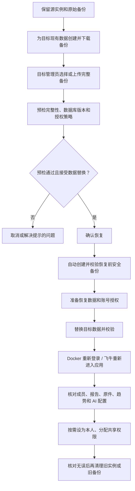
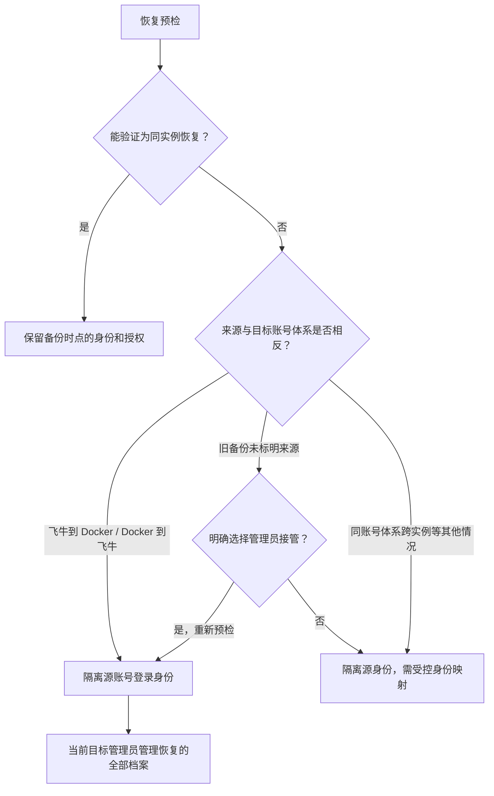
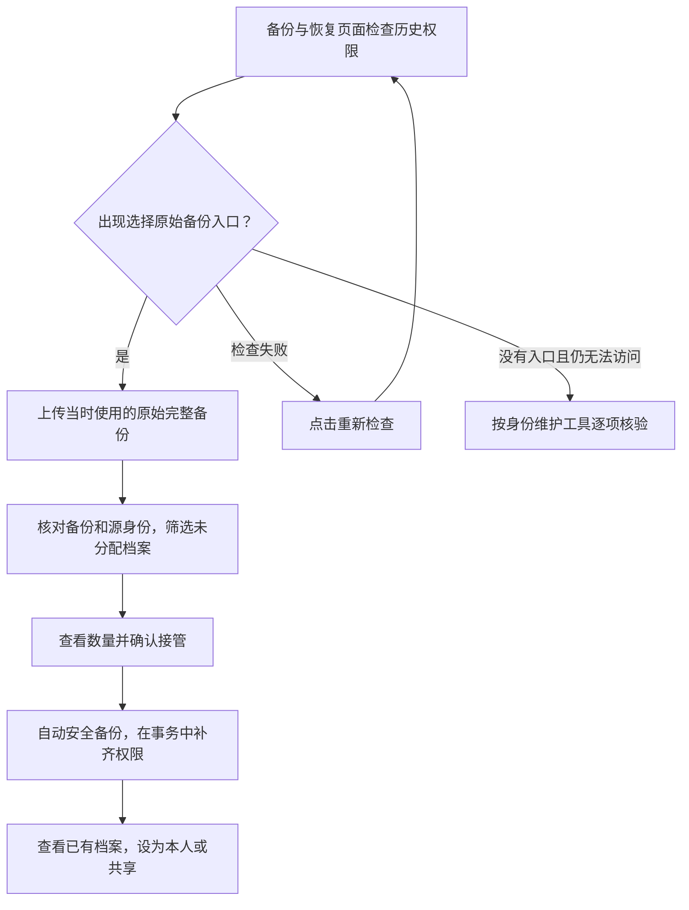

# 备份、恢复与迁移

> **完整恢复会替换目标实例的数据、配置和密钥，不会追加或合并已有档案。**
> 恢复前会自动生成安全备份。备份包含医疗数据和凭据，请保存在可信位置，建议加密并限制访问权限。

本文中的飞牛 ↔ Docker 双向接管适用于包含本轮调整的 **0.2.13**；发布状态以 [CHANGELOG](../CHANGELOG.md) 为准。

## 先选择操作

| 你的目的 | 使用方式 | 结果 |
| --- | --- | --- |
| 保存当前数据 | 应用内完整备份 | 生成备份，不改变当前数据 |
| 回到备份时点 | 同实例完整恢复 | 数据、账号及授权回到备份时点 |
| 飞牛迁到 Docker，或反向迁移 | 在目标应用内恢复完整备份 | 替换目标业务数据，由目标管理员接管档案 |
| 保留目标已有数据，同时追加备份档案 | 当前完整恢复不支持 | 不要用完整恢复进行追加；成员合并也不能合并恢复前后两套数据库 |

## 应用内完整备份

进入“我的 → 维护工具 → 备份与恢复”，创建并下载完整备份。

| 备份包含 | 校验信息 |
| --- | --- |
| SQLite 一致性快照、报告原件、分页图、缩略图 | 文件大小、SHA-256 校验清单 |
| 运行配置、AI 配置及加密凭据 | 完整性与数据库兼容性检查 |

大文件下载或上传失败时，参考[常见问题排查](./TROUBLESHOOTING.md)。

## 恢复和跨设备迁移

在目标实例中，由**目标环境管理员**执行恢复。跨设备迁移先建立目标实例，再使用应用内恢复，不直接复制源数据卷作为身份迁移。



**注解**

- **预检**：目标应用必须支持备份的 schema；查看确认页的来源、档案数量及授权结果。预检不替换业务数据。
- **确认**：恢复会清除登录会话；上传恢复在预检、确认时各上传一次同一文件。确认凭据有效期为 15 分钟，备份、身份或权限变化后需重新预检。
- **执行**：仍有识别、归一化、维护、导出或其他请求未结束时，恢复不会执行。失败处理见[回滚限制](#回滚限制)。
- **核对**：安全备份用于回退，不代表两边数据已经融合。确认无误前保留源实例、原始备份和安全备份。

### 跨账号体系双向恢复的授权边界

以下为策略示意，实际以预检结果为准。



| 迁移方向 | 谁管理恢复档案 | 如何重新进入 | 后续分配给谁 |
| --- | --- | --- | --- |
| 飞牛 → Docker | 执行恢复的 Docker 管理员 | 使用目标管理员原有本地凭据登录 | Docker 本地账号 |
| Docker → 飞牛 | 执行恢复的飞牛管理员 | 通过目标飞牛网关重新进入 | 目标飞牛账号 |

**注解**

- **不转换源账号**：源账号作为隔离的历史记录保留，不自动创建对应的目标登录账号。只重新登记已验证的目标管理员内部身份，保留其本地凭据或飞牛网关身份，避免内部 ID 冲突。
- **不猜测本人**：姓名、用户名或数值 UID 相同不证明身份相同；不自动合并同名成员，也不继承源账号的本人关联和隐藏偏好。
- **不改动归属**：成员 ID、报告归属和创建者不变。接管包括回收站档案，但不会改变删除状态。
- **权限范围**：目标管理员获得管理和共享管理权限；分享后仍保留原权限，后续调整遵循最后管理者保护。
- **来源判断**：读取备份 `manifest.json` 的 `identity.authMode`，目标模式由服务端确定；文件名或容器标记不决定授权。来源元数据只是策略信息，不是身份证明。

### 恢复后的档案分配

| 要做什么 | 操作 | 是否需要新建成员 |
| --- | --- | --- |
| 将恢复档案作为自己的档案 | 家庭成员管理 → 已有档案 → 设为本人 | 不需要；也可暂不选择 |
| 让家人访问恢复档案 | 成员共享 → 选择目标账号 → 仅查看或管理 | 不需要 |
| 创建 Docker 家人的登录账号 | 备份与恢复 → 管理账号，或“我的 → 账号安全” | 只创建登录账号，不必新建档案 |
| 处理确实属于同一人的两份档案 | 使用现有成员档案合并，核对身份及最终权限 | 按需合并，不是恢复必经步骤 |

共享确认会标明接收账号与档案范围；Docker 列表同时显示名称和登录用户名，便于区分同名账号。取消不会改变授权，失败保留原权限显示。

### 已恢复但看不到档案

仅最近一次隔离恢复的执行管理员可核对原备份，修复尚未分配的跨账号体系档案权限。



**注解**

- 上传原备份**只用于核对，不重新恢复数据**，不会覆盖已经新增的数据。
- 必须保留恢复记录、源身份关联等证据；校验备份 ID、完整性、成员 ID 和创建者。已经映射或已有有效共享管理者的档案跳过。
- 确认凭据绑定文件、管理员、部署及当前权限；变化后重新检查。失败不保留部分授权，成功后修复入口消失。
- 普通账号不能查看候选身份和数量。没有原备份或可信证据时，不提供通用接管；参阅[身份恢复维护工具](./IDENTITY_RECOVERY.md)。检查失败不代表没有待处理档案。

## 回滚限制

| 情况 | 处理方式 |
| --- | --- |
| 恢复失败且自动回滚成功 | 保留目标原数据和权限，排查原因后重试 |
| 回滚失败或恢复进程中断 | 保持维护状态，不开放半恢复数据；保留维护记录、安全备份与回滚目录 |
| 想回退到旧应用版本 | 先确认旧镜像或 FPK 支持当前 schema；不支持时，用升级前备份在独立实例验证 |

**不要手工删除维护标记绕过恢复。** 新版本可能执行数据库迁移，数据不能靠启动旧版本直接降级。

### 恢复中断后的回滚

停止服务，保留运行目录 `restore-maintenance.json`、安全备份与 `.rollback-*` 目录。在仓库环境使用 Node 24，先在复制的数据目录验证：

```bash
node scripts/maintenance/restore-rollback.mjs --runtime /target/runtime --storage /target/archive
```

核对预览输出，将本次摘要传给相同命令，添加 `--apply --service-stopped --confirm 摘要`。工具校验安全备份并恢复数据库与文件；保留目标部署锚点和机器目录配置，成功后才移除维护标记。

## Docker 数据备份

优先使用应用内完整备份。以下数据卷备份用于停机保存数据，**不代替跨账号体系的应用内恢复流程**。

```bash
docker compose stop health-records
docker run --rm \
  -v fnos-health-records-data:/data:ro \
  -v "$PWD":/backup alpine:3.22 \
  tar -C /data -czf /backup/fnos-health-records-data.tar.gz .
docker compose start health-records
```

使用 `DATA_HOST_PATH` 时，停止容器后备份该主机目录。不要只备份 `REPORTS_HOST_PATH`：它只是外部源报告目录，不包含数据库和已处理结果。同实例恢复数据目录或数据卷也必须先停止应用。

## 身份与授权恢复

以下为特殊情况和维护参考，日常操作优先看上面的流程图。

<details>
<summary>展开：同实例、旧备份与受控身份映射</summary>

| 预检结果或情况 | 身份与权限处理 |
| --- | --- |
| 同实例，操作者身份可验证 | 账号凭据、启停状态、授权、本人关联和隐藏偏好回到备份时点；普通账号不统一停用。当前已验证管理员的凭据和强制改密状态保留，原来只有查看权限的档案不会提升权限 |
| 同实例，操作者不在备份中且无法核实原管理员凭据 | 保留独立系统维护身份，不自动给予成员权限 |
| 其他跨实例或身份无法确认，未采用接管策略 | 源账号待映射、源登录隔离；当前管理员仅保留系统维护身份 |
| 旧备份缺少部署元数据 | 只以本地随机内部身份匹配，或同一内部用户 ID 加完整一致凭据辅助判断同实例；不按姓名或用户名猜测 |

**0.2.8 等旧备份**：曾重建本地管理员时，账号行 ID 可能变化。同一内部用户 ID 与完整本地凭据都匹配，才辅助认定为同实例；仅用户名相同或凭据不同，仍隔离处理。

**旧备份曾被错误隔离**：保留当前数据卷和原始备份，找到该次恢复前的安全备份。对安全备份重新预检；只有显示同实例恢复才确认回退，之后重新登录并核对账号、成员。任何一步仍显示跨实例隔离，都不要反复恢复，应使用受控映射工具。安全备份中的原管理员凭据完全匹配时，可恢复原身份及其授权，否则继续隔离。

目标运行目录的 `deployment-identity.json` 是本地部署锚点，不随应用内业务备份覆盖；实例标识不是登录凭证。fnOS 内部账号 ID 与网关 UID 已分离。

</details>

### 跨实例映射与历史错误修复

参阅[身份恢复维护工具](./IDENTITY_RECOVERY.md)。默认只读预览，核实源、目标账号实际持有人后逐项确认；不改写创建者、不移动报告、不合并同名档案。映射后自行确认本人关联、默认选择和隐藏设置。

## 未完成的补充报告页

| 随备份保留 | 恢复后的处理 |
| --- | --- |
| 补充批次、检查点、reports/thumbnails 中的文件及预览 | 继续复核原账号绑定和管理权限；身份待确认时不自动继续发布 |
| 已完成 OCR、AI 任务检查点 | 不重复完成的 OCR；AI 失败重试使用原检查点 |

详见[补充报告页](./REPORT_PAGE_APPEND.md)。

## 反馈安装身份

<details>
<summary>展开：反馈记录为什么会随备份迁移</summary>

反馈安装身份保存在数据库 `app_settings` 的内部键 `x-client-id` 中。数据库就绪后生成，首次反馈请求兜底检查：使用 32 字节安全随机数，编码为 43 位 Base64URL。浏览器无需读取，不写入日志或公开诊断。

| 备份情况 | 恢复后的反馈身份 |
| --- | --- |
| 备份含身份 | 使用备份中的身份 |
| 旧备份无身份，目标已有身份 | 保留目标身份 |
| 两边均无身份 | 启动或首次反馈请求时生成 |
| 身份损坏 | 不静默重置 |

完整备份同时保留反馈状态基线、通知和各管理员阅读记录。把同一备份恢复到多个实例会共享反馈记录；反馈身份与本地权限隔离的部署身份不同，不改变 fnOS / Docker 鉴权。

备份包含反馈访问凭证，不要公开分享备份或内部配置值。持有完整备份或控制服务器的人可在应用外读取其中的数据和密钥；应用内管理员权限隔离不改变此边界。

</details>

## 自动化恢复验收

<details>
<summary>展开：开发者测试与容器验收命令</summary>

| 验证方式 | 覆盖范围 |
| --- | --- |
| `packages/server/tests/restore-takeover.test.ts` | 双向存储/上传恢复、网关身份重新进入、源账号隔离、本人与共享、旧备份选择、令牌与权限变化、历史修复、切换前后回滚、双向 HTTP 上传 |
| `packages/ui/tests/restore-takeover.test.ts` | 单次确认、选项重新预检、失败回退、普通账号不可见 |
| 容器验收脚本 | 打包飞牛启动器 → 真实 Docker 容器恢复、登录、原件读取及受限共享 |

启动 Docker，准备本地已有、包含 Node 22 与 tar 的运行时镜像，例如 `fnos-health-records:test`：

```bash
GATEWAY_PREFIX=/ npm run build
npm run prepare:package
node scripts/tests/restore-docker.mjs fnos-health-records:test
```

脚本使用合成账号和数据、临时镜像与 tmpfs，结束后自动清理，不访问现有数据卷，不发布产物。macOS 测试源禁用 AppleDouble 元数据，以匹配 Linux 归档行为。

该脚本不替代物理 NAS 网关及授权目录验收；后者需独立 fnOS 测试实例。本轮双向恢复使用现有授权结构，schema 保持 v19，无新增结构或迁移。

</details>
